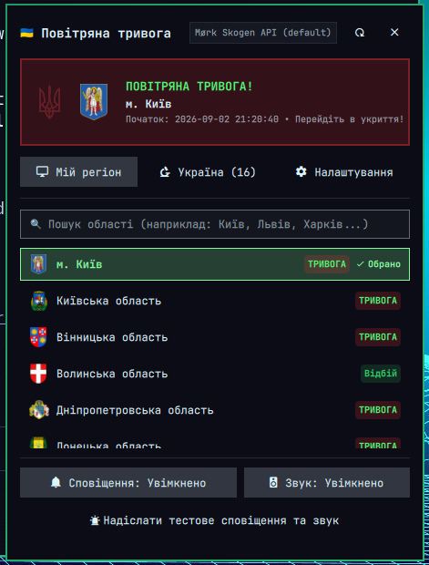

# Omarchy Air Raid Alert Plugin for Ukraine 🇺🇦

[](LICENSE)
[](https://omarchy.org/)

An official-grade **Omarchy Linux status bar (dock) plugin** providing real-time air raid alarm (**Повітряна тривога**) monitoring, oblast selection, popout details panel, and urgent desktop + audio siren notifications for Ukraine.

<p align="center">
  
</p>

---

## ⚡ Features

- **Dock / Bar Widget**: Real-time status icon in the Omarchy bar:
  - 🇺🇦 **Ukrainian Trident (Тризуб)**:
    - 🟢 **All-Clear State**: Solid vibrant emerald green (`#22c55e`). Tooltip displays your selected oblast and safe status.
    - 🚨 **Urgent Alert State**: Turns crimson red (`#ef4444`) and **blinks continuously** with a pulsing alert badge whenever an air raid alarm is active in your oblast.
- **Rich Popup Panel**: Click the dock icon to open a sleek Quickshell popout card:
  - **Hero Status Banner**: Displays the Ukrainian Trident and the **official Coat of Arms** of your selected oblast with real-time status and shelter warnings.
  - **Oblast Selector with Official Emblems**: Choose which oblast you live in (all 24 oblasts + Kyiv City + Crimea/Sevastopol), featuring the **official SVG Coat of Arms** for every single region and live search filtering.
  - **National Overview**: Live count of active alerts across Ukraine, with active oblasts highlighted on top.
  - **Provider & Settings Manager**: Switch API providers, enter API tokens, configure polling intervals (15s, 30s, 60s), and toggle notifications or sound.
- **Desktop Notifications**: Automatic urgent notifications triggered via `omarchy-notification-send`:
  - `🚨 ПОВІТРЯНА ТРИВОГА!` when an alert starts in your region.
  - `🟢 ВІДБІЙ ТРИВОГИ` when an alert is cleared.
- **Sound Alerts**: Built-in sound effects played via PipeWire (`pw-play`):
  - Attention-grabbing two-tone siren (`assets/siren.wav`) when an alarm begins.
  - Ascending harmonic chime (`assets/clear.wav`) on all-clear.
- **Zero-Config, Free API-less**: Powered out of the box by the open community Ubilling / Mørk Skogen API (`https://ubilling.net.ua/aerialalerts/`). No registration, API tokens, or account setup required.

---

## 🚀 Installation

Install it with Omarchy's own plugin command — no cloning, no symlinks:

```bash
omarchy plugin install https://github.com/gladimdim/omarchy-air-raid-alert-ukraine-plugin.git --enable
```

(`omarchy plugin add` is the same command under its original name.)

Omarchy does the rest for you:

1. Shows the standard "plugins run unsandboxed code" warning and asks you to confirm the URL.
2. Installs into `~/.config/omarchy/plugins/gladimdim.air-raid-alert` and validates it against the plugin manifest schema.
3. Asks which bar section to put it in — press Enter to accept the manifest default, `right`.
4. Enables it live. The trident shows up in your bar immediately; **no shell restart needed**.

Open the popup and pick your oblast — that is the only setup step. The default provider needs no account and no API token.

### Unattended install

`--yes` skips both prompts and places the widget in the manifest's default section (`right`):

```bash
omarchy plugin install https://github.com/gladimdim/omarchy-air-raid-alert-ukraine-plugin.git --enable --yes
```

### Install now, enable later

Drop `--enable` to just add the plugin, then enable it whenever you like and choose exactly where it sits:

```bash
omarchy plugin install https://github.com/gladimdim/omarchy-air-raid-alert-ukraine-plugin.git
omarchy plugin enable gladimdim.air-raid-alert --section right
```

`omarchy plugin enable` also takes `--index`, `--before <widget-id>` and `--after <widget-id>` if you want it in a particular spot within that section.

---

## 🔄 Updating

```bash
omarchy plugin update gladimdim.air-raid-alert
```

It fetches upstream, shows you the diff, fast-forwards the installed copy, and re-validates the manifest — rolling the update back if validation fails. Add `--yes` to skip the diff and the confirmation. Running `omarchy plugin update` with no id updates every plugin you installed this way.

---

## 🗑️ Removal

```bash
omarchy plugin remove gladimdim.air-raid-alert
```

That one command does the whole job: it disables the widget (dropping it from your bar layout), deletes `~/.config/omarchy/plugins/gladimdim.air-raid-alert`, and rescans the shell. It asks for confirmation first; pass `--yes` to skip the prompt.

To take it out by hand instead:

```bash
omarchy plugin disable gladimdim.air-raid-alert
rm -rf ~/.config/omarchy/plugins/gladimdim.air-raid-alert
omarchy restart shell
```

Your settings live in `~/.config/omarchy/air-raid-alert.json`; delete that file too if you want nothing left behind.

If you ever need to reload the shell, use `omarchy restart shell`, **not** `omarchy refresh shell` — the latter resets `~/.config/omarchy/shell.json` to Omarchy defaults and discards your bar layout and plugin settings.

---

## 🔒 Security & Privacy

- **User-space execution**: Operates entirely under standard user permissions. No elevated permissions or root access required.
- **Injection-safe process calls**: All command arguments are passed as structured arrays (no `shell=True` or unescaped string interpolations).
- **Privacy-conscious**: No telemetry, analytics, or background coordinates collected.
- **Secure token storage**: API keys are saved locally in `~/.config/omarchy/air-raid-alert.json` and sent exclusively via HTTPS `Authorization` headers.
- **Strict Sandbox compliance**: Contains no internal symlinks; strictly passes `omarchy plugin validate`.

## 🖥️ Usage

### Mouse Actions on Dock Icon
- **Left Click**: Toggles the interactive Popup Monitor.
- **Right Click**: Triggers an instant data refresh from the active API provider.

### Inside the Popup Panel
- **Tab 1: Мій регіон (My Region)**:
  - Use the search box to find your oblast (e.g. `Київ`, `Львів`, `Харків`, `Одеса`, `Дніпро`).
  - Click any oblast row to immediately set it as your monitored region.
  - Toggle desktop notifications and audio siren.
  - Click **"Надіслати тестове сповіщення та звук"** to test your setup.
- **Tab 2: Україна (National Status)**:
  - View how many oblasts are currently under alert across the entire country.
  - Check active alerts and start timestamps in other regions.
- **Tab 3: Налаштування (Settings)**:
  - Configure notification and sound toggles.
  - Set polling frequency (15s, 20s, 30s, or 60s).
  - Test siren or all-clear sound clips, and send a test screen notification.

---

## ⚙️ Configuration File

Settings are saved automatically to `~/.config/omarchy/air-raid-alert.json`:

```json
{
  "selectedOblast": "м. Київ",
  "provider": "ubilling",
  "apiKey": "",
  "notificationsEnabled": true,
  "soundEnabled": true,
  "refreshIntervalSec": 20,
  "fallbackToUbilling": true,
  "showOblastInBar": true
}
```

---

## 🛠️ CLI & Headless Usage

The included `alert_engine.py` can also be run independently from the command line:

```bash
# Fetch latest status across Ukraine and print normalized JSON
python3 alert_engine.py --fetch

# Change your monitored oblast to Lviv
python3 alert_engine.py --set-oblast "Львівська область"

# Switch provider to alerts.in.ua and provide a token
python3 alert_engine.py --set-provider alerts_in_ua --set-api-key "YOUR_TOKEN"

# Send a test desktop notification and play siren
python3 alert_engine.py --test-notification

# Play sound directly
python3 alert_engine.py --play-siren
python3 alert_engine.py --play-clear
```

---

## 🧪 Unit Tests

Run test suite:

```bash
python3 -m unittest discover -s tests
```

Tests cover:
- Region name normalization (Cyrillic, Latin, abbreviations).
- Configuration loading and persistence.
- Mock API parsing for Ubilling, alerts.in.ua, and UkraineAlarm.
- Automatic fallback handling when primary API token fails or expires.

---

## 📜 License

MIT License. Developed for [Omarchy Linux](https://omarchy.org/).
Author: **Dmytro Gladkyi**
